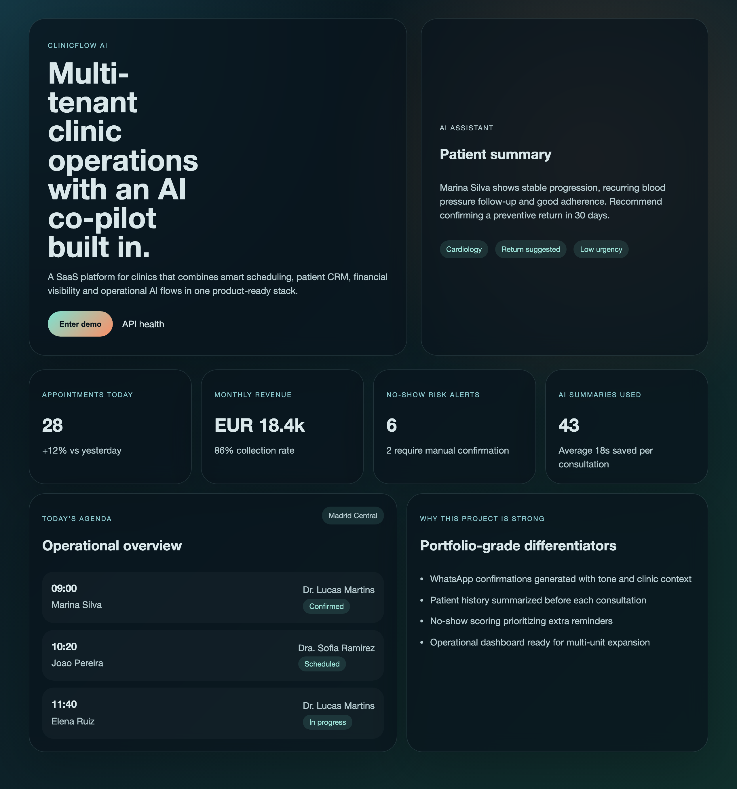

# ClinicFlow AI

**Clinic operations SaaS foundation with tenant-aware workflows and early AI-assisted features.**

This project focuses on appointment management, patient and professional records, operational dashboards and an API-first backend. The repository contains a React admin interface and modular backend areas for API, domain, application and infrastructure.

**Portfolio status:** an early-stage product foundation, not a certified clinical system. Persistence, authentication/authorization depth, fuller frontend-to-API integration and expanded AI workflows are identified as next steps. Do not use it for real patient care or store real patient data without appropriate security, privacy, clinical validation and compliance work.

**Engineering themes:** .NET backend architecture, SaaS domain modelling, tenant boundaries, React integration and responsible AI-assisted workflows.

---

ClinicFlow AI is a multi-tenant clinic management SaaS positioned around scheduling, patient CRM, operational dashboards and AI-assisted clinical workflows.

## Why this repository is valuable

- multi-tenant SaaS narrative
- clinic operations domain with real business flows
- backend architecture plus admin web shell
- AI-assisted product direction instead of generic CRUD only

## Current scope

- authentication entry point
- tenant-aware patient and professional management
- appointment lifecycle
- dashboard summary
- AI phase 1 endpoints for patient summaries and confirmation messages

## Screenshots

### Admin Dashboard



### Mobile View


## Repository structure

```text
apps/admin_web/        # React admin shell
backend/               # ClinicFlow backend modules
docs/                  # screenshots and architectural context
infra/                 # infrastructure-oriented files
```

## Backend modules

- `backend/src/ClinicFlow.Api`
- `backend/src/ClinicFlow.Domain`
- `backend/src/ClinicFlow.Application`
- `backend/src/ClinicFlow.Infrastructure`

## Local run

### Backend

```bash
cd backend/src/ClinicFlow.Api
dotnet run
```

### Frontend

```bash
cd apps/admin_web
npm install
npm run dev
```

## Current positioning

ClinicFlow AI is already shaped as a portfolio-ready SaaS foundation, with a clearer path toward PostgreSQL, JWT auth, richer medical workflows and stronger OpenAI-powered features.

## Recommended next steps

1. replace in-memory persistence with PostgreSQL
2. add JWT and role-based authorization
3. connect the admin web shell to the API in a fuller way
4. introduce medical records and payment persistence
5. expand AI workflows beyond phase 1
